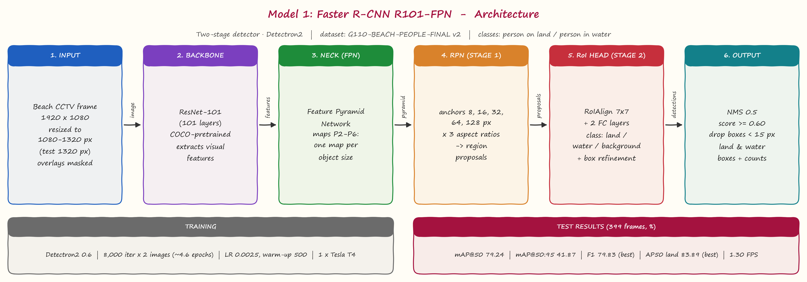
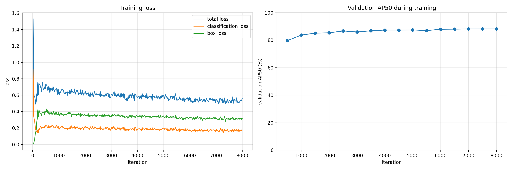
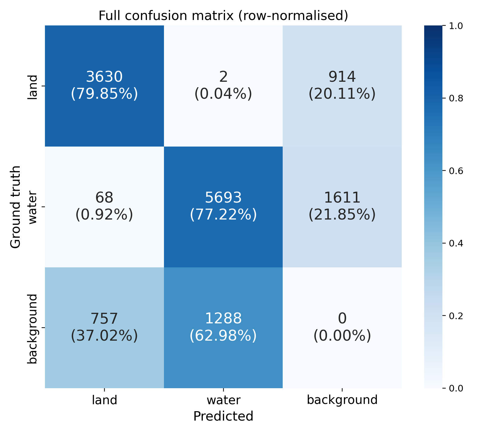
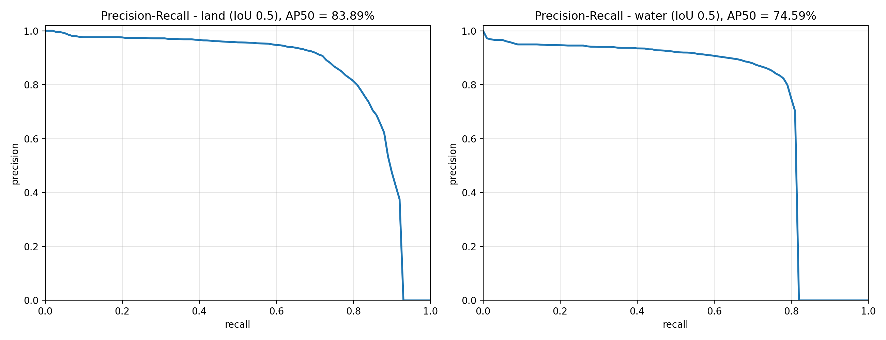
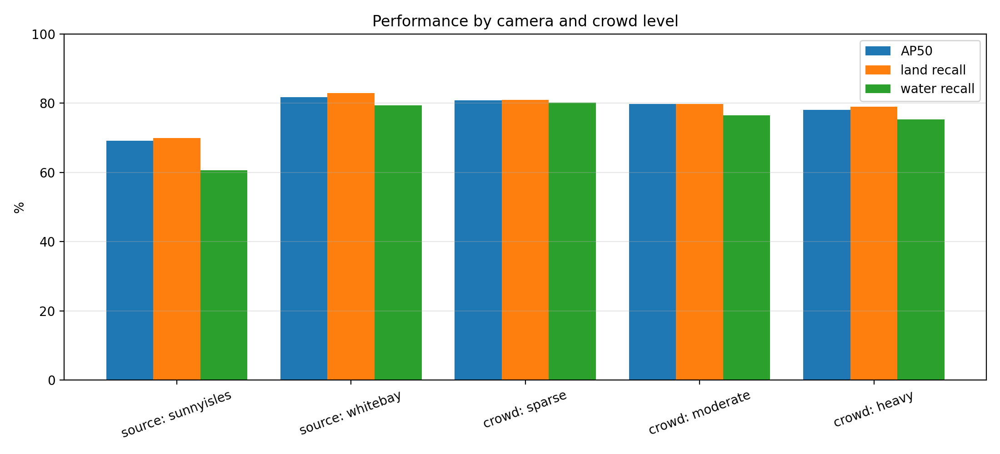
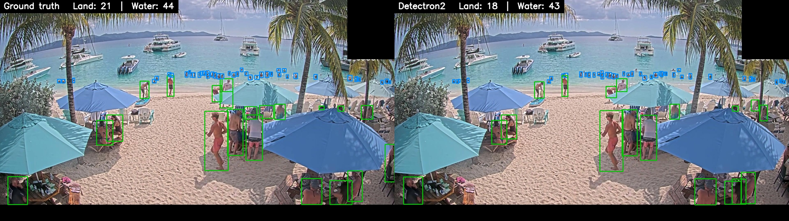
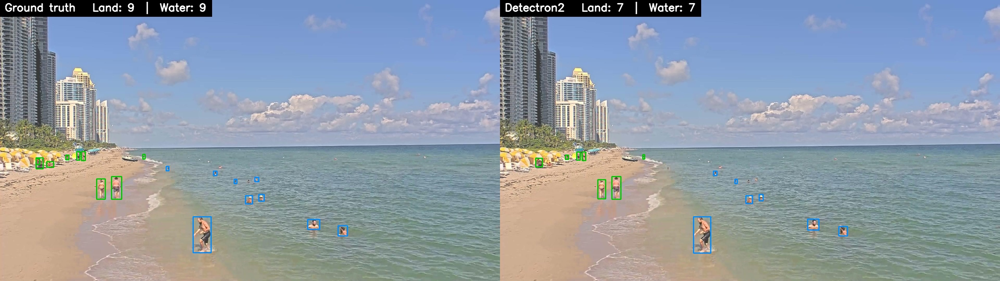

# Faster R-CNN R101-FPN — Model Documentation

**Project:** Coastal Human Surveillance: Dual-Zone Pedestrian & Swimmer Risk Analytics via High-Resolution Vision Detectors  

**Model owner:** M. Balaji Sakthivel (CB.SC.U4CSE23213)  

**Guide:** Ms. R. Sujee, Assistant Professor, Department of CSE, Amrita Vishwa Vidyapeetham, Coimbatore

---

## 1. Overview

This model detects every person in a frame from a fixed beach camera and classifies each one as **on land (class 0)** or **in the water (class 1)**. From these detections it produces per-frame land / water head-counts.

It is the **deepest two-stage detector** of the five models, chosen to measure what a strong, proposal-based detector achieves on small, crowded beach scenes. It is trained, selected and evaluated with exactly the same data and rules as the other four models, so all results can be compared directly.

| Item | Value |
|---|---|
| Framework | Detectron2 0.6 (PyTorch) |
| Base model | `COCO-Detection/faster_rcnn_R_101_FPN_3x` (COCO-pretrained) |
| Model family | two-stage detector |
| Task | 2-class object detection: person on land / person in water |
| Dataset | [G110-BEACH-PEOPLE-FINAL](https://app.roboflow.com/mbalajis-workspace-g2gae/g110-beach-people-final/2), Roboflow version 2 |

---

## 2. How the model works



*Architecture of the model as implemented in our notebook: the detection pipeline (top), the training setup and the test results (bottom).*

Step by step:

```
Input frame (1920x1080, resized to 1320 px)
   -> ResNet-101 backbone            : deep residual CNN (101 layers), extracts visual features
   -> Feature Pyramid Network (FPN)  : feature maps P2-P6, one per object size
   -> Region Proposal Network (RPN)  : stage 1 - anchors of 8, 16, 32, 64, 128 px x 3 aspect ratios
                                       propose boxes that may contain a person
   -> RoIAlign (7x7) + box head      : stage 2 - crops each proposal and classifies it as
                                       land / water / background, and refines the box
   -> Post-processing                : NMS (IoU 0.5), score >= 0.60, boxes shorter than 15 px removed
   -> Output                         : land and water boxes + per-frame land / water counts
```

- **Why small anchors?** People far from the camera — especially swimmers — are only 15–40 px tall. The default anchors start at 32 px, so they were reduced to 8–128 px.
- **Why high resolution?** At the usual 640 px input, far swimmers shrink to a few pixels and disappear; 1080–1320 px keeps them detectable.
- **Loss:** `L = L_cls(RPN) + L_box(RPN) + L_cls(RoI) + L_box(RoI)` — cross-entropy for classification and smooth-L1 for box regression, in both stages.

---

## 3. Dataset

The dataset was built by the team for this project from two public, fixed beach webcams.

| Split | Frames | Boxes | Land | Water |
|---|---|---|---|---|
| Train | 3,454 | 132,027 | 57,634 | 74,393 |
| Validation | 782 | 31,443 | 13,558 | 17,885 |
| Test (people ≥ 15 px) | 399 | 11,918 | 4,546 | 7,372 |

- **Cameras:** White Bay, British Virgin Islands (crowded) and Sunny Isles, USA (far, small people).
- **Frames:** one frame every 3 s from 48 clips of about 5 minutes, 1920×1080; stream overlays masked.
- **Labels:** draft boxes → YOLOv8x labeller → verified cleaning rules; land / water decided by the person's foot point relative to the waterline of each camera.
- **Split:** by clip, so frames of one clip never appear in two splits; the test clips come from a different day.
- **Test set:** completed by eye; people under 15 px are an *ignore region* — detecting them is neither rewarded nor punished.

---

## 4. Training configuration

| Setting | Value |
|---|---|
| Pretrained weights | COCO (Detectron2 model zoo) |
| Iterations | 8,000 × batch 2 images ≈ 4.6 epochs |
| Learning rate | 0.0025, 500 warm-up iterations, ×0.1 at 70 % and 90 % of training |
| Mixed precision | enabled (AMP) |
| Training sizes | shortest side 1080 / 1200 / 1320 px (max 2400) |
| Test size | 1320 px (max 2400) |
| Anchors | 8, 16, 32, 64, 128 px × 3 aspect ratios |
| RoI batch per image | 256 |
| Checkpoint selection | validation AP50 every 500 iterations; the **best** checkpoint is kept |
| Score threshold | chosen on validation → **0.60** |
| Hardware | 1 × Tesla T4 (16 GB) |

---

## 5. Step-by-step: what was done

1. **Download the dataset** — G110-BEACH-PEOPLE-FINAL v2 from Roboflow.
2. **Mark small people** — test boxes shorter than 15 px become ignore regions (same rule for all 5 models).
3. **Configure Detectron2** — load the R101-FPN COCO model, set 2 classes, small anchors and high resolution.
4. Train for 8,000 iterations; validation AP50 is measured every 500 iterations and the best checkpoint is saved as `model_best.pth`.
5. **Choose the score threshold** — predict on the validation split and pick the threshold that maximises F1(land) + F1(water); the test set is never used for this choice.
6. **Evaluate once on the test split** — COCO mAP, per-class precision / recall / F1, 3×3 confusion matrix, results per camera and per crowd level, per-frame counting error and speed.
7. **With / without study** — repeat the test prediction with denoising, CLAHE, different NMS thresholds, test-time augmentation and the plain COCO model.
8. **Render outputs** — ground-truth vs model sample frames and output videos.

---

## 6. Results (test split: 399 frames, 4,546 land + 7,372 water people)

### 6.1 Main metrics

| Metric | Value |
|---|---|
| **mAP@50** | **79.24 %** |
| mAP@50:95 | 41.87 % |
| AP50 land / water | **83.89 %** (best of 5) / 74.59 % |
| Precision / recall — land | 81.48 % / 79.85 % |
| Precision / recall — water | 81.53 % / 77.22 % |
| F1 (support-weighted) | **79.83 %** (best of 5) |
| Speed | 1.30 frames/s at 1320 px (Tesla T4) |

### 6.2 Per camera and counting error

| | White Bay (crowded) | Sunny Isles (far, small people) |
|---|---|---|
| mAP@50 | 81.78 % | **69.16 %** (best of 5) |
| Count error, land (people / frame) | **1.44** | **1.02** |
| Count error, water (people / frame) | 2.64 | **1.44** |

### 6.3 With / without study (AP50, %)

| Variant | AP50 |
|---|---|
| Baseline (raw frames) | 79.24 |
| Bilateral denoising | 75.96 |
| **CLAHE** | **80.13** (best variant) |
| Denoising + CLAHE | 78.02 |
| NMS 0.3 / 0.7 | 77.91 / 79.37 |
| Test-time augmentation | 77.95 |
| COCO model, no fine-tuning | 59.29 |

### 6.4 Reading the results

- **Land and water are almost never confused** (0.04 % land→water, 0.92 % water→land). The main error is *missed* people (about 20 %), mostly far swimmers and people hidden by umbrellas.
- It is the **most balanced detector**: best F1, best on people on land and the lowest counting error — but also the **slowest** of the five.
- **Fine-tuning is essential**: +20 points over the plain COCO model. **CLAHE helps** (+0.9) against glare; **denoising hurts** (−3.3) because it blurs small people.

---

## 7. Figures

| Training curves | Confusion matrix (row-normalised) |
|---|---|
|  |  |

| Precision–recall curves | Results per camera and crowd level |
|---|---|
|  |  |

**Ground truth (left) vs model (right)** — green = land, blue = water




---

## 8. Output videos

All videos are in [`Output/Videos`](Output/Videos) (H.264 MP4). Click a file, then *View raw* to play it.

| Video | Shows |
|---|---|

| `video_GT_vs_Detectron2_ALL_test_clips.mp4` | ground truth vs model on all four test clips |

| `video_GT_vs_Detectron2_sunnyisles_001_20261110_224944.mp4` | ground truth vs model, test clip Sunny Isles 001 |

| `video_GT_vs_Detectron2_sunnyisles_002_20261110_225435.mp4` | ground truth vs model, test clip Sunny Isles 002 |

| `video_GT_vs_Detectron2_whitebay_001_20261110_224945.mp4` | ground truth vs model, test clip White Bay 001 |

| `video_GT_vs_Detectron2_whitebay_002_20261110_225438.mp4` | ground truth vs model, test clip White Bay 002 |

| `video_continuous_sunnyisles_001_20261110_224944.mp4` | model at real speed with live land / water counts, Sunny Isles clip 001 |

| `video_continuous_sunnyisles_002_20261110_225435.mp4` | model at real speed with live land / water counts, Sunny Isles clip 002 |

| `video_continuous_whitebay_001_20261110_224945.mp4` | model at real speed with live land / water counts, White Bay clip 001 |

| `video_continuous_whitebay_002_20261110_225438.mp4` | model at real speed with live land / water counts, White Bay clip 002 |

---

## 9. How to reproduce on Kaggle

1. Create a Kaggle notebook with **GPU T4** and **Internet** enabled.
2. Upload the notebook from [`Notebooks/`](Notebooks).
3. Add your Roboflow API key as a Kaggle secret named `ROBOFLOW_API_KEY` (Add-ons → Secrets), or paste it where the notebook says `PASTE_YOUR_ROBOFLOW_KEY_HERE`. **Never commit a real key.**
4. Run all cells — the notebook downloads the dataset, trains, keeps the best checkpoint and writes all results and videos.

5. To skip training, download `FasterRCNN_R101_model_best.pth` from the [repository releases](https://github.com/MBalajiSakthivel007/G110_Github/releases) and load it in the evaluation part of the notebook.

---

## 10. Files in this folder

| Path | Content |
|---|---|

| `Notebooks/Detectron2_R101_training.ipynb` | Kaggle notebook with all saved outputs |

| `Notebooks/Detectron2_R101_evaluation_v2.ipynb` | Kaggle notebook with all saved outputs |

| `Output/Charts/` | training curves, confusion matrices, precision–recall curves, threshold sweep, per-camera results, counts over time |
| `Output/Sample_Frames/` | ground truth vs model frames and pre-processing comparisons |
| `Output/Metrics/` | all numbers: COCO metrics, confusion, per camera, counts, threshold choice, configuration used |

| `Output/Videos/` | 9 output videos (see section 8) |

All results are also in the [OneDrive results folder](https://amritavishwavidyapeetham-my.sharepoint.com/:f:/g/personal/cb_sc_u4cse23213_cb_students_amrita_edu/IgA5mwnmggnnTJXEs_IHnSQNAZUTOkk0YJnSnPzW1UB8OW8).

---

## 11. Limitations

- Two cameras, daylight only; very small or fully hidden people are still missed.

- Slowest of the five models (1.30 frames/s) — better suited to offline analysis than to live use on a small device.

- Training length was limited by Kaggle's 12-hour session limit.

## 12. References (IEEE)

1. S. Ren, K. He, R. Girshick, and J. Sun, "Faster R-CNN: Towards real-time object detection with region proposal networks," *IEEE TPAMI*, vol. 39, no. 6, pp. 1137–1149, 2017.
2. T.-Y. Lin *et al.*, "Feature pyramid networks for object detection," in *Proc. IEEE CVPR*, 2017, pp. 2117–2125.
3. K. He, X. Zhang, S. Ren, and J. Sun, "Deep residual learning for image recognition," in *Proc. IEEE CVPR*, 2016, pp. 770–778.
4. M. Li, Y. Hu, H. Chen, and X. Li, "Feature-Enhanced Faster R-CNN for Small Object Detection in Complex Scenes," *IEEE Access*, vol. 13, 2025.
5. Y. Yu, K. Zhang, X. Wang, N. Wang, and X. Gao, "An Adaptive Region Proposal Network With Progressive Attention Propagation for Tiny Person Detection From UAV Images," *IEEE TCSVT*, vol. 34, no. 6, pp. 4392–4406, 2024.
