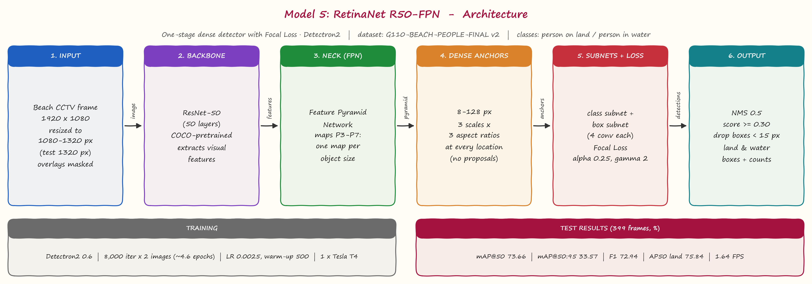
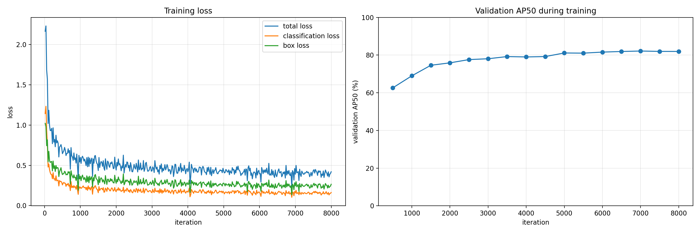
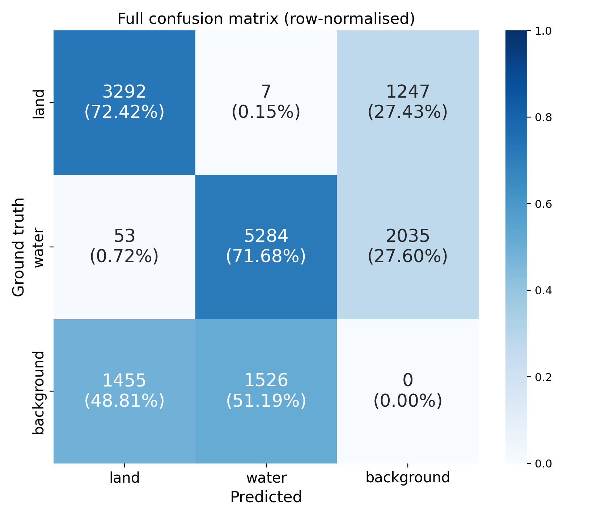
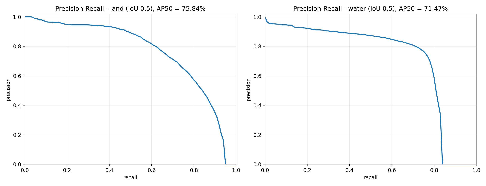
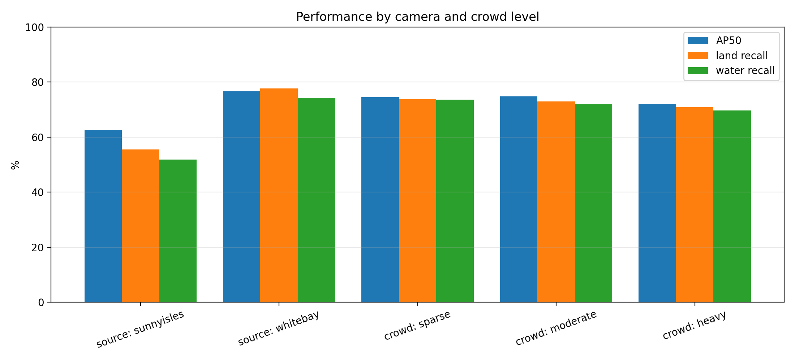
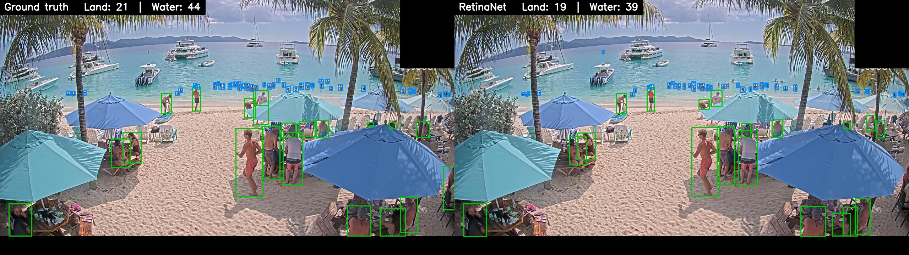
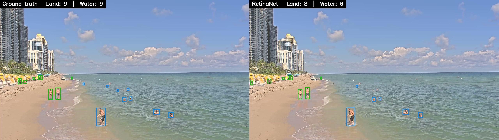

# RetinaNet R50-FPN — Model Documentation

**Project:** Coastal Human Surveillance: Dual-Zone Pedestrian & Swimmer Risk Analytics via High-Resolution Vision Detectors  

**Model owner:** Shaik Ibbraheem (CB.SC.U4CSE23742)  

**Guide:** Ms. R. Sujee, Assistant Professor, Department of CSE, Amrita Vishwa Vidyapeetham, Coimbatore

---

## 1. Overview

This model detects every person in a frame from a fixed beach camera and classifies each one as **on land (class 0)** or **in the water (class 1)**. From these detections it produces per-frame land / water head-counts.

It is a **one-stage dense detector trained with Focal Loss**. It shares the backbone, data and schedule of Faster R-CNN R50-FPN, so the pair is a direct **one-stage vs two-stage** comparison. It is trained, selected and evaluated with exactly the same data and rules as the other four models, so all results can be compared directly.

| Item | Value |
|---|---|
| Framework | Detectron2 0.6 (PyTorch) |
| Base model | `COCO-Detection/retinanet_R_50_FPN_3x` (COCO-pretrained) |
| Model family | one-stage dense detector with Focal Loss |
| Task | 2-class object detection: person on land / person in water |
| Dataset | [G110-BEACH-PEOPLE-FINAL](https://app.roboflow.com/mbalajis-workspace-g2gae/g110-beach-people-final/2), Roboflow version 2 |

---

## 2. How the model works



*Architecture of the model as implemented in our notebook: the detection pipeline (top), the training setup and the test results (bottom).*

Step by step:

```
Input frame (1920x1080, resized to 1320 px)
   -> ResNet-50 backbone             : residual CNN (50 layers), COCO weights
   -> Feature Pyramid Network (FPN)  : feature maps P3-P7, one per object size
   -> Dense anchors                  : 8-128 px, 3 scales x 3 aspect ratios at every location - no proposal stage
   -> Class subnet + box subnet      : 4 conv layers each, shared across pyramid levels
   -> Loss                           : Focal Loss (alpha 0.25, gamma 2) + smooth-L1 for boxes
   -> Post-processing                : NMS (IoU 0.5), score >= 0.30, boxes shorter than 15 px removed
   -> Output                         : land and water boxes + per-frame land / water counts
```

- **Focal Loss** `FL(p_t) = -α_t (1-p_t)^γ log(p_t)` down-weights the huge number of easy background anchors (sand, sea).
- **One stage:** no proposals — classification and box regression happen directly at every anchor.

---

## 3. Dataset

The dataset was built by the team for this project from two public, fixed beach webcams.

| Split | Frames | Boxes | Land | Water |
|---|---|---|---|---|
| Train | 3,454 | 132,027 | 57,634 | 74,393 |
| Validation | 782 | 31,443 | 13,558 | 17,885 |
| Test (people ≥ 15 px) | 399 | 11,918 | 4,546 | 7,372 |

- **Cameras:** White Bay, British Virgin Islands (crowded) and Sunny Isles, USA (far, small people).
- **Frames:** one frame every 3 s from 48 clips of about 5 minutes, 1920×1080; stream overlays masked.
- **Labels:** draft boxes → YOLOv8x labeller → verified cleaning rules; land / water decided by the person's foot point relative to the waterline of each camera.
- **Split:** by clip, so frames of one clip never appear in two splits; the test clips come from a different day.
- **Test set:** completed by eye; people under 15 px are an *ignore region* — detecting them is neither rewarded nor punished.

---

## 4. Training configuration

| Setting | Value |
|---|---|
| Pretrained weights | COCO (Detectron2 model zoo) |
| Iterations | 8,000 × batch 2 images ≈ 4.6 epochs |
| Learning rate | 0.0025, 500 warm-up iterations, ×0.1 at 70 % and 90 % of training |
| Mixed precision | enabled (AMP) |
| Training sizes | shortest side 1080 / 1200 / 1320 px (max 2400) |
| Test size | 1320 px (max 2400) |
| Anchors | 8–128 px, 3 scales × 3 aspect ratios per level |
| Checkpoint selection | validation AP50 every 500 iterations; best checkpoint kept |
| Score threshold | chosen on validation → **0.30** |
| Hardware | 1 × Tesla T4 (16 GB) |

---

## 5. Step-by-step: what was done

1. **Download the dataset** — G110-BEACH-PEOPLE-FINAL v2 from Roboflow.
2. **Mark small people** — test boxes shorter than 15 px become ignore regions (same rule for all 5 models).
3. **Configure Detectron2** — load the RetinaNet R50-FPN COCO model, set 2 classes and small anchors.
4. Train for 8,000 iterations; keep the checkpoint with the best validation AP50.
5. **Choose the score threshold** — predict on the validation split and pick the threshold that maximises F1(land) + F1(water); the test set is never used for this choice.
6. **Evaluate once on the test split** — COCO mAP, per-class precision / recall / F1, 3×3 confusion matrix, results per camera and per crowd level, per-frame counting error and speed.
7. **With / without study** — repeat the test prediction with denoising, CLAHE, different NMS thresholds, test-time augmentation and the plain COCO model.
8. **Render outputs** — ground-truth vs model sample frames and output videos.

---

## 6. Results (test split: 399 frames, 4,546 land + 7,372 water people)

### 6.1 Main metrics

| Metric | Value |
|---|---|
| **mAP@50** | **73.66 %** |
| mAP@50:95 | 33.57 % |
| AP50 land / water | 75.84 % / 71.47 % |
| Precision / recall — land | 68.58 % / 72.42 % |
| Precision / recall — water | 77.51 % / 71.68 % |
| F1 (support-weighted) | 72.94 % |
| Speed | 1.64 frames/s at 1320 px |

### 6.2 Per camera and counting error

| | White Bay (crowded) | Sunny Isles (far, small people) |
|---|---|---|
| mAP@50 | 76.67 % | 62.51 % |
| Count error, land (people / frame) | 2.44 | 1.28 |
| Count error, water (people / frame) | 3.43 | 1.84 |

### 6.3 With / without study (AP50, %)

| Variant | AP50 |
|---|---|
| Baseline (raw frames) | 73.66 |
| Bilateral denoising | 71.06 |
| CLAHE | 73.80 |
| Denoising + CLAHE | 72.02 |
| NMS 0.3 / 0.7 | 71.90 / 72.56 |
| **Test-time augmentation** | **75.98** (best variant) |
| COCO model, no fine-tuning | 51.41 |

### 6.4 Reading the results

- Land↔water mix-ups stay below 1 % (0.15 % / 0.72 %), but about 27 % of people are missed and it has the most false boxes of all models.
- With the same backbone and schedule, the **two-stage Faster R-CNN R50 is 3.8 points better** — the proposal + RoI refinement stage matters for small, crowded people.
- **Test-time augmentation** gives the largest gain of all models (+2.3).

---

## 7. Figures

| Training curves | Confusion matrix (row-normalised) |
|---|---|
|  |  |

| Precision–recall curves | Results per camera and crowd level |
|---|---|
|  |  |

**Ground truth (left) vs model (right)** — green = land, blue = water




---

## 8. Output videos

All videos are in [`Output/Videos`](Output/Videos) (H.264 MP4). Click a file, then *View raw* to play it.

| Video | Shows |
|---|---|

| `video_GT_vs_RetinaNet_ALL_test_clips.mp4` | ground truth vs model on all four test clips |

| `video_GT_vs_RetinaNet_sunnyisles_001_20261110_224944.mp4` | ground truth vs model, test clip Sunny Isles 001 |

| `video_GT_vs_RetinaNet_sunnyisles_002_20261110_225435.mp4` | ground truth vs model, test clip Sunny Isles 002 |

| `video_GT_vs_RetinaNet_whitebay_001_20261110_224945.mp4` | ground truth vs model, test clip White Bay 001 |

| `video_GT_vs_RetinaNet_whitebay_002_20261110_225438.mp4` | ground truth vs model, test clip White Bay 002 |

| `video_continuous_sunnyisles_001_20261110_224944.mp4` | model at real speed with live land / water counts, Sunny Isles clip 001 |

| `video_continuous_sunnyisles_002_20261110_225435.mp4` | model at real speed with live land / water counts, Sunny Isles clip 002 |

| `video_continuous_whitebay_001_20261110_224945.mp4` | model at real speed with live land / water counts, White Bay clip 001 |

| `video_continuous_whitebay_002_20261110_225438.mp4` | model at real speed with live land / water counts, White Bay clip 002 |

---

## 9. How to reproduce on Kaggle

1. Create a Kaggle notebook with **GPU T4** and **Internet** enabled.
2. Upload the notebook from [`Notebooks/`](Notebooks).
3. Add your Roboflow API key as a Kaggle secret named `ROBOFLOW_API_KEY` (Add-ons → Secrets), or paste it where the notebook says `PASTE_YOUR_ROBOFLOW_KEY_HERE`. **Never commit a real key.**
4. Run all cells — the notebook downloads the dataset, trains, keeps the best checkpoint and writes all results and videos.

5. To skip training, download `RetinaNet_R50_model_best.pth` from the [repository releases](https://github.com/MBalajiSakthivel007/G110_Github/releases) and load it in the evaluation part of the notebook.

---

## 10. Files in this folder

| Path | Content |
|---|---|

| `Notebooks/RetinaNet_R50_v2.ipynb` | Kaggle notebook with all saved outputs |

| `Output/Charts/` | training curves, confusion matrices, precision–recall curves, threshold sweep, per-camera results, counts over time |
| `Output/Sample_Frames/` | ground truth vs model frames and pre-processing comparisons |
| `Output/Metrics/` | all numbers: COCO metrics, confusion, per camera, counts, threshold choice, configuration used |

| `Output/Videos/` | 9 output videos (see section 8) |

All results are also in the [OneDrive results folder](https://amritavishwavidyapeetham-my.sharepoint.com/:f:/g/personal/cb_sc_u4cse23213_cb_students_amrita_edu/IgCmaOegT5zFQYtvwCHbV3BEATn1BsVDDP3my6-UmXfyXpM?e=H9Y6Zh).

---

## 11. Limitations

- Two cameras, daylight only; very small or fully hidden people are still missed.

- Its best validation threshold was the lowest value tried (0.30); a lower threshold search may help.

- Training length was limited by Kaggle's 12-hour session limit.

## 12. References (IEEE)

1. T.-Y. Lin, P. Goyal, R. Girshick, K. He, and P. Dollár, "Focal loss for dense object detection," in *Proc. IEEE ICCV*, 2017, pp. 2980–2988.
2. P. P. Khin and N. M. Htaik, "Gun Detection: A Comparative Study of RetinaNet, EfficientDet and YOLOv8 on Custom Dataset," in *Proc. IEEE ICCA*, 2024, pp. 1–7.
3. Y. Zhang and Z. Cai, "CE-RetinaNet: A Channel Enhancement Method for Infrared Wildlife Detection in UAV Images," *IEEE TGRS*, vol. 61, 2023.
