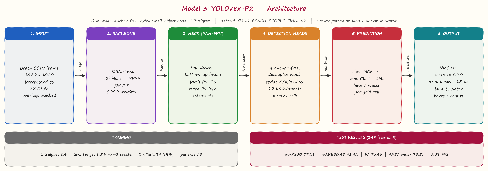
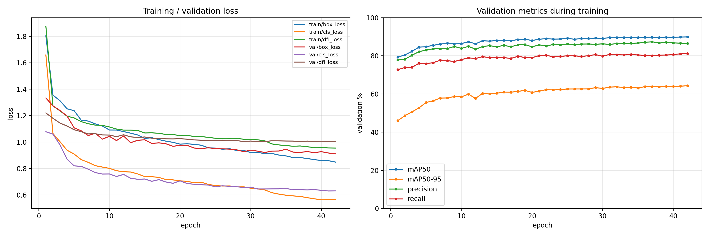
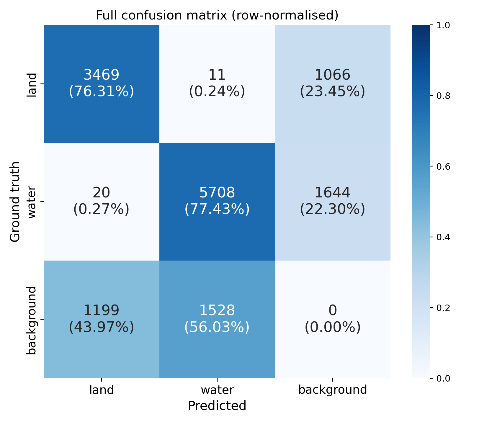
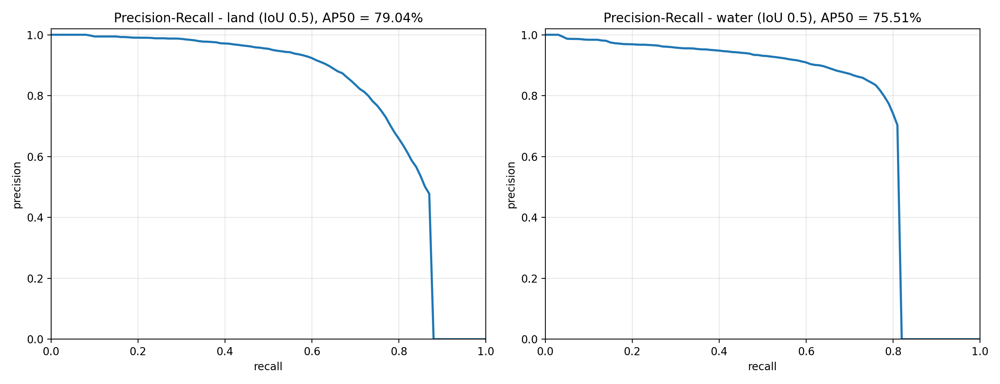
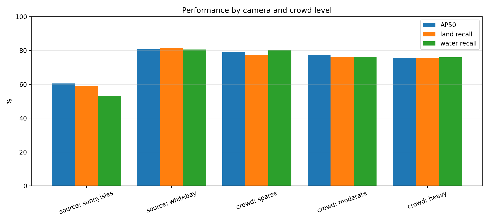
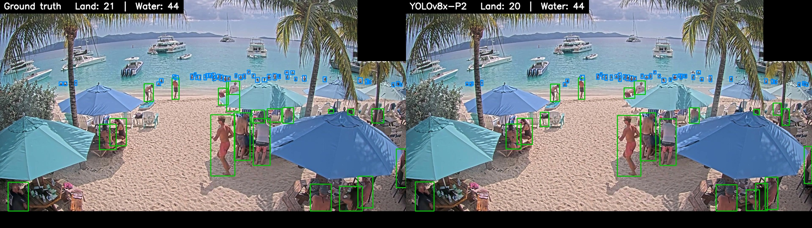
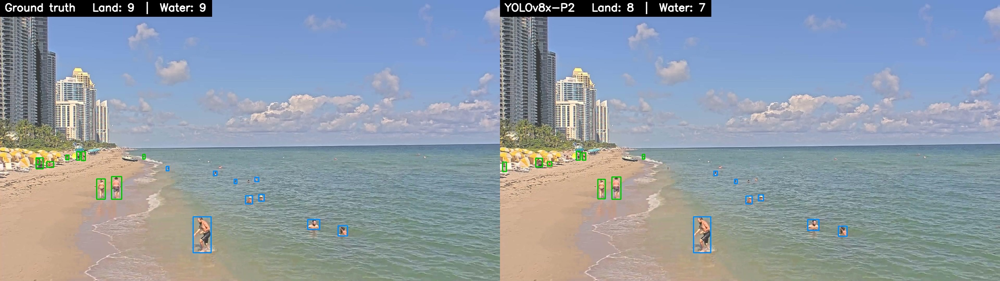

# YOLOv8x-P2 — Model Documentation

**Project:** Coastal Human Surveillance: Dual-Zone Pedestrian & Swimmer Risk Analytics via High-Resolution Vision Detectors  

**Model owner:** R. Shanmugham (CB.SC.U4CSE23257)  

**Guide:** Ms. R. Sujee, Assistant Professor, Department of CSE, Amrita Vishwa Vidyapeetham, Coimbatore

---

## 1. Overview

This model detects every person in a frame from a fixed beach camera and classifies each one as **on land (class 0)** or **in the water (class 1)**. From these detections it produces per-frame land / water head-counts.

It is a **one-stage, anchor-free** detector with an **extra P2 (stride-4) head** for very small objects, chosen because far swimmers are only 15–40 px tall. It is trained, selected and evaluated with exactly the same data and rules as the other four models, so all results can be compared directly.

| Item | Value |
|---|---|
| Framework | Ultralytics 8.4 (PyTorch) |
| Base model | `yolov8x-p2.yaml` initialised from `yolov8x.pt` (COCO-pretrained) |
| Model family | one-stage, anchor-free detector with an extra small-object head |
| Task | 2-class object detection: person on land / person in water |
| Dataset | [G110-BEACH-PEOPLE-FINAL](https://app.roboflow.com/mbalajis-workspace-g2gae/g110-beach-people-final/2), Roboflow version 2 |

---

## 2. How the model works



*Architecture of the model as implemented in our notebook: the detection pipeline (top), the training setup and the test results (bottom).*

Step by step:

```
Input frame (1920x1080, letterboxed to 1280 px)
   -> CSPDarknet backbone (C2f + SPPF) : extracts visual features (yolov8x COCO weights)
   -> PAN-FPN neck                     : top-down + bottom-up fusion of levels P2-P5
   -> 4 anchor-free decoupled heads    : strides 4 / 8 / 16 / 32 - the extra stride-4 (P2) head keeps
                                         a 15 px swimmer at about 4x4 grid cells
   -> Prediction                       : class scores (BCE) and boxes (CIoU + DFL) per grid cell
   -> Post-processing                  : NMS (IoU 0.5), score >= 0.30, boxes shorter than 15 px removed
   -> Output                           : land and water boxes + per-frame land / water counts
```

- **One stage:** every grid cell directly predicts a class and a box — no proposals and no anchors.
- **Loss:** CIoU + Distribution Focal Loss for boxes, binary cross-entropy for classes (weights 7.5 / 1.5 / 0.5).

---

## 3. Dataset

The dataset was built by the team for this project from two public, fixed beach webcams.

| Split | Frames | Boxes | Land | Water |
|---|---|---|---|---|
| Train | 3,454 | 132,027 | 57,634 | 74,393 |
| Validation | 782 | 31,443 | 13,558 | 17,885 |
| Test (people ≥ 15 px) | 399 | 11,918 | 4,546 | 7,372 |

- **Cameras:** White Bay, British Virgin Islands (crowded) and Sunny Isles, USA (far, small people).
- **Frames:** one frame every 3 s from 48 clips of about 5 minutes, 1920×1080; stream overlays masked.
- **Labels:** draft boxes → YOLOv8x labeller → verified cleaning rules; land / water decided by the person's foot point relative to the waterline of each camera.
- **Split:** by clip, so frames of one clip never appear in two splits; the test clips come from a different day.
- **Test set:** completed by eye; people under 15 px are an *ignore region* — detecting them is neither rewarded nor punished.

---

## 4. Training configuration

| Setting | Value |
|---|---|
| Input size | 1280 px (letterboxed) |
| Training length | fixed time budget of 8.5 h — Ultralytics fits epochs and learning-rate schedule to the time |
| GPUs | 2 × Tesla T4 (DDP) |
| Early stopping | patience 15 epochs |
| Augmentation | Ultralytics defaults |
| Epochs reached | 42 in 8.5 h |
| Checkpoint selection | best epoch on validation (`best.pt`) |
| Score threshold | chosen on validation → **0.30** |

---

## 5. Step-by-step: what was done

1. **Download the dataset** — G110-BEACH-PEOPLE-FINAL v2 from Roboflow.
2. **Mark small people** — test boxes shorter than 15 px become ignore regions (same rule for all 5 models).
3. Build YOLOv8x with the P2 head (`yolov8x-p2.yaml`) and load the COCO `yolov8x.pt` weights.
4. Train on 2 GPUs within an 8.5 h budget (42 epochs); Ultralytics keeps the best epoch as `best.pt`.
5. **Choose the score threshold** — predict on the validation split and pick the threshold that maximises F1(land) + F1(water); the test set is never used for this choice.
6. **Evaluate once on the test split** — COCO mAP, per-class precision / recall / F1, 3×3 confusion matrix, results per camera and per crowd level, per-frame counting error and speed.
7. **With / without study** — repeat the test prediction with denoising, CLAHE, different NMS thresholds, test-time augmentation and the plain COCO model.
8. **Render outputs** — ground-truth vs model sample frames and output videos.

---

## 6. Results (test split: 399 frames, 4,546 land + 7,372 water people)

### 6.1 Main metrics

| Metric | Value |
|---|---|
| **mAP@50** | **77.28 %** |
| mAP@50:95 | 41.42 % |
| AP50 land / water | 79.04 % / 75.51 % |
| Precision / recall — land | 74.00 % / 76.31 % |
| Precision / recall — water | 78.76 % / 77.43 % |
| F1 (support-weighted) | 76.96 % |
| Speed | 2.58 frames/s at 1280 px (second fastest) |

### 6.2 Per camera and counting error

| | White Bay (crowded) | Sunny Isles (far, small people) |
|---|---|---|
| mAP@50 | 80.79 % | 60.55 % |
| Count error, land (people / frame) | 2.06 | 1.27 |
| Count error, water (people / frame) | 2.82 | 1.76 |

### 6.3 With / without study (AP50, %)

| Variant | AP50 |
|---|---|
| Baseline (raw frames) | 77.28 |
| Bilateral denoising | 75.50 |
| CLAHE | 77.29 |
| Denoising + CLAHE | 76.11 |
| NMS 0.3 / 0.7 | 75.56 / 77.53 |
| **Test-time augmentation** | **78.83** (best variant) |
| COCO model, no fine-tuning | 59.00 |

### 6.4 Reading the results

- Land↔water mix-ups stay below 1 %; recall on swimmers is good, but there are more false boxes on land because of the low threshold (0.30).
- All losses were still falling when the 8.5 h budget ended — the model is **under-trained** and would improve with longer training.
- **Test-time augmentation** gives +1.6 points.

---

## 7. Figures

| Training curves | Confusion matrix (row-normalised) |
|---|---|
|  |  |

| Precision–recall curves | Results per camera and crowd level |
|---|---|
|  |  |

**Ground truth (left) vs model (right)** — green = land, blue = water




---

## 8. Output videos

All videos are in [`Output/Videos`](Output/Videos) (H.264 MP4). Click a file, then *View raw* to play it.

| Video | Shows |
|---|---|

| `video_GT_vs_YOLOv8x-P2_ALL_test_clips.mp4` | ground truth vs model on all four test clips |

| `video_GT_vs_YOLOv8x-P2_sunnyisles_001_20261110_224944.mp4` | ground truth vs model, test clip Sunny Isles 001 |

| `video_GT_vs_YOLOv8x-P2_sunnyisles_002_20261110_225435.mp4` | ground truth vs model, test clip Sunny Isles 002 |

| `video_GT_vs_YOLOv8x-P2_whitebay_001_20261110_224945.mp4` | ground truth vs model, test clip White Bay 001 |

| `video_GT_vs_YOLOv8x-P2_whitebay_002_20261110_225438.mp4` | ground truth vs model, test clip White Bay 002 |

| `video_continuous_sunnyisles_001_20261110_224944.mp4` | model at real speed with live land / water counts, Sunny Isles clip 001 |

| `video_continuous_sunnyisles_002_20261110_225435.mp4` | model at real speed with live land / water counts, Sunny Isles clip 002 |

| `video_continuous_whitebay_001_20261110_224945.mp4` | model at real speed with live land / water counts, White Bay clip 001 |

| `video_continuous_whitebay_002_20261110_225438.mp4` | model at real speed with live land / water counts, White Bay clip 002 |

---

## 9. How to reproduce on Kaggle

1. Create a Kaggle notebook with **GPU T4** and **Internet** enabled.
2. Upload the notebook from [`Notebooks/`](Notebooks).
3. Add your Roboflow API key as a Kaggle secret named `ROBOFLOW_API_KEY` (Add-ons → Secrets), or paste it where the notebook says `PASTE_YOUR_ROBOFLOW_KEY_HERE`. **Never commit a real key.**
4. Run all cells — the notebook downloads the dataset, trains, keeps the best checkpoint and writes all results and videos.

5. To skip training, download `YOLOv8x_P2_best.pt` (and `YOLOv8x_P2_last.pt`) from the [repository releases](https://github.com/MBalajiSakthivel007/G110_Github/releases) and load it in the evaluation part of the notebook.

---

## 10. Files in this folder

| Path | Content |
|---|---|

| `Notebooks/YOLOv8x_P2_v2.ipynb` | Kaggle notebook with all saved outputs |

| `Output/Charts/` | training curves, confusion matrices, precision–recall curves, threshold sweep, per-camera results, counts over time |
| `Output/Sample_Frames/` | ground truth vs model frames and pre-processing comparisons |
| `Output/Metrics/` | all numbers: COCO metrics, confusion, per camera, counts, threshold choice, configuration used |

| `Output/Training_Run/` | Ultralytics training run: loss curves, `results.csv`, training / validation batches, arguments used |

| `Output/Videos/` | 9 output videos (see section 8) |

All results are also in the [OneDrive results folder](https://amritavishwavidyapeetham-my.sharepoint.com/:f:/g/personal/cb_sc_u4cse23213_cb_students_amrita_edu/IgBalhNFqHZJRYnuJkDITIPgAeLdlZfW4IwV0mHwKsO1A44?e=NgldMw).

---

## 11. Limitations

- Two cameras, daylight only; very small or fully hidden people are still missed.

- Training stopped at 42 epochs because of the time budget; validation metrics were still rising.

- Training length was limited by Kaggle's 12-hour session limit.

## 12. References (IEEE)

1. M. Hussain, "YOLOv1 to v8: Unveiling Each Variant—A Comprehensive Review of YOLO," *IEEE Access*, vol. 12, pp. 42816–42833, 2024.
2. F. N. M. Zamri *et al.*, "Enhanced Small Drone Detection Using Optimized YOLOv8 With Attention Mechanisms," *IEEE Access*, vol. 12, 2024.
3. T. Sun *et al.*, "MIS-YOLOv8: An Improved Algorithm for Detecting Small Objects in UAV Aerial Photography Based on YOLOv8," *IEEE TIM*, vol. 74, 2025.
