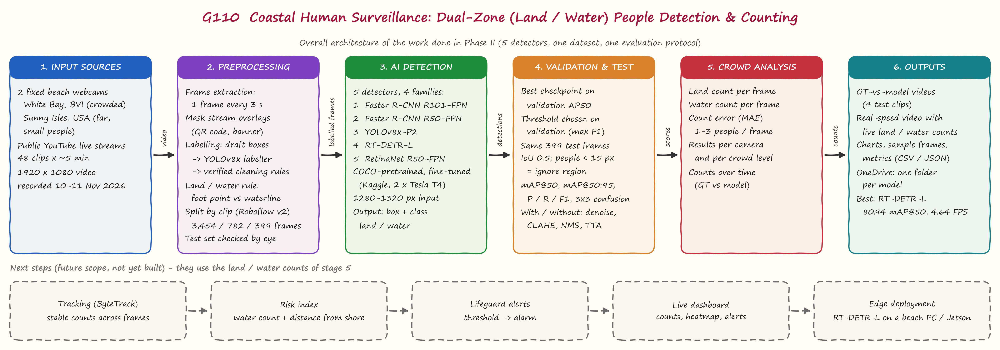

# Coastal Human Surveillance

**Dual-Zone Pedestrian and Swimmer Risk Analytics via High-Resolution Vision Detectors**

Final-year project (23CSE498 – Project Phase II), Team G110, Department of Computer Science and Engineering,
Amrita School of Computing, Amrita Vishwa Vidyapeetham, Coimbatore.

[Project website](https://mbalajisakthivel007.github.io/G110_Website/) ·
[Documentation](docs/Phase2_Project_Documentation.md) ·
[Project report](Phase2/Report/G110_Phase2_Report.pdf) ·
[Research paper](Phase2/Paper/Coastal_Human_Surveillance_Research_Paper.pdf) ·
[Trained weights](https://github.com/MBalajiSakthivel007/G110_Github/releases) ·
[Dataset](https://app.roboflow.com/mbalajis-workspace-g2gae/g110-beach-people-final/2)

---

## Overview

Lifeguards on crowded beaches have to keep track of how many people are on the sand and how many are in the
water, usually by eye and for long hours. Doing this automatically from an ordinary beach camera is difficult:
swimmers far from the camera are only 15–40 pixels tall, people overlap in crowds, and umbrellas, boats and waves
are easily mistaken for people. Existing person detectors also have no notion of *where* a person is — they cannot
tell someone on the beach from someone in the sea.

This project detects every person in a fixed beach-camera frame, classifies each one as **on land** or
**in the water**, and reports both counts for every frame. We built our own two-class dataset from two public beach
webcams and compared five detectors of different design families under exactly the same training and evaluation
protocol.

## System architecture



The initial design and the architecture of each detector are in [`Phase2/Architecture`](Phase2/Architecture).

## Dataset

The dataset (*G110-BEACH-PEOPLE-FINAL*, Roboflow version 2) was collected from two fixed webcams — White Bay,
British Virgin Islands, and Sunny Isles, USA — sampled at one frame every three seconds and split by clip, so that
no clip appears in more than one split. The test clips were recorded on a different day and completed by hand.
A person counts as *in the water* when the bottom-centre of their box lies inside the waterline polygon of the camera.

| Split | Frames | People | On land | In water |
|---|---:|---:|---:|---:|
| Train | 3,454 | 132,027 | 57,634 | 74,393 |
| Validation | 782 | 31,443 | 13,558 | 17,885 |
| Test | 399 | 11,918 | 4,546 | 7,372 |

## Models and results

All models start from COCO weights, use high-resolution input (1280–1320 px), select their checkpoint and score
threshold on the validation split, and are evaluated once on the same 399 test frames. People smaller than 15 px
in the test set are treated as ignore regions.

| Model | Type | mAP@50 | mAP@50:95 | AP50 (water) | F1 | Frames/s |
|---|---|---:|---:|---:|---:|---:|
| RT-DETR-L | detection transformer | **80.94** | **44.83** | **80.23** | 78.42 | **4.64** |
| Faster R-CNN R101-FPN | two-stage | 79.24 | 41.87 | 74.59 | **79.83** | 1.30 |
| Faster R-CNN R50-FPN | two-stage | 77.50 | 40.15 | 73.00 | 78.47 | 1.70 |
| YOLOv8x-P2 | one-stage, small-object head | 77.28 | 41.42 | 75.51 | 76.96 | 2.58 |
| RetinaNet R50-FPN | one-stage, focal loss | 73.66 | 33.57 | 71.47 | 72.94 | 1.64 |

Speed measured on a single NVIDIA Tesla T4.

Main observations:

- RT-DETR-L gives the highest accuracy and is also the fastest, which makes it the most suitable model for live use.
- Faster R-CNN R101-FPN is the most balanced model, with the best F1 score and the lowest counting error.
- Land and water are almost never confused (below 1 % for every model); the remaining errors are mostly distant
  swimmers and people hidden behind umbrellas.
- The per-frame count is off by only one to three people on scenes with up to fifty people.
- Fine-tuning on our data adds 14–22 mAP points over a COCO-only detector.

Full results, the with/without study and the analysis are in the
[project documentation](docs/Phase2_Project_Documentation.md) and the [project report](Phase2/Report/G110_Phase2_Report.pdf).

## Repository layout

```
docs/                        project documentation
Phase2/
    Architecture/            system and model architecture diagrams
    Report/                  project report (PDF)
    Paper/                   research paper (PDF)
    References/              literature survey papers
    Detectron2/              Faster R-CNN R101-FPN
    FasterRCNN/              Faster R-CNN R50-FPN
    YOLO/                    YOLOv8x-P2
    RT-DETR/                 RT-DETR-L
    RetinaNet/               RetinaNet R50-FPN
```

Each model folder contains a documentation file, the Kaggle notebooks (`Notebooks/`) and the evaluation outputs
(`Output/`): charts, sample frames, metrics and videos.

| Model | Documentation |
|---|---|
| Faster R-CNN R101-FPN | [Detectron2_FasterRCNN_R101_Documentation.md](Phase2/Detectron2/Detectron2_FasterRCNN_R101_Documentation.md) |
| Faster R-CNN R50-FPN | [FasterRCNN_R50_Documentation.md](Phase2/FasterRCNN/FasterRCNN_R50_Documentation.md) |
| YOLOv8x-P2 | [YOLOv8x_P2_Documentation.md](Phase2/YOLO/YOLOv8x_P2_Documentation.md) |
| RT-DETR-L | [RTDETR_L_Documentation.md](Phase2/RT-DETR/RTDETR_L_Documentation.md) |
| RetinaNet R50-FPN | [RetinaNet_R50_Documentation.md](Phase2/RetinaNet/RetinaNet_R50_Documentation.md) |

## Running the notebooks

The notebooks were run on Kaggle with a Tesla T4 GPU.

1. Upload a notebook from `Phase2/<model>/Notebooks/` to Kaggle and enable the GPU and internet access.
2. Add a Roboflow API key as a Kaggle secret named `ROBOFLOW_API_KEY`.
3. Run all cells. The notebook downloads the dataset, trains the model, selects the checkpoint and threshold on the
   validation split and writes all metrics, charts and videos to the output folder.

Trained weights are available under [Releases](https://github.com/MBalajiSakthivel007/G110_Github/releases).

## Team

| Register number | Name | Model |
|---|---|---|
| CB.SC.U4CSE23213 | M. Balaji Sakthivel | Faster R-CNN R101-FPN |
| CB.SC.U4CSE23214 | Chitturi Venkata Chaitanya | RT-DETR-L |
| CB.SC.U4CSE23257 | R. Shanmugham | YOLOv8x-P2 |
| CB.SC.U4CSE23711 | Bhargava Ram Kaza | Faster R-CNN R50-FPN |
| CB.SC.U4CSE23742 | Shaik Ibbraheem | RetinaNet R50-FPN |

Project guide: Ms. R. Sujee, Assistant Professor, Department of Computer Science and Engineering.

## References

The literature survey (20 IEEE papers, grouped by model, with links) is in
[`Phase2/References`](Phase2/References/Literature_Survey_Papers.md).

## License

The code in this repository is released under the [MIT License](LICENSE). The webcam footage belongs to its owners
and was used for academic research only.
