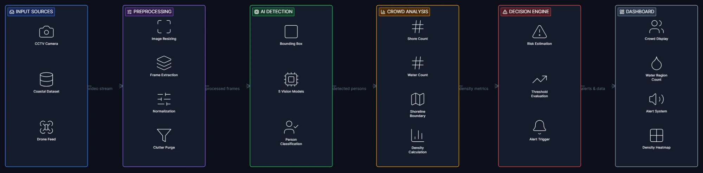
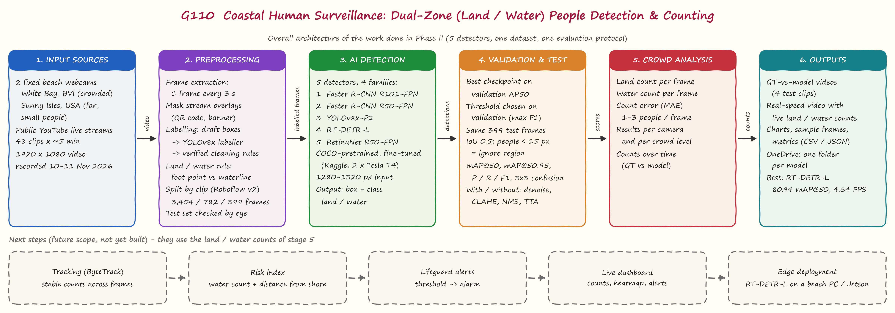
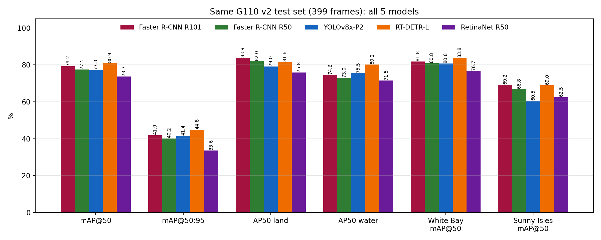
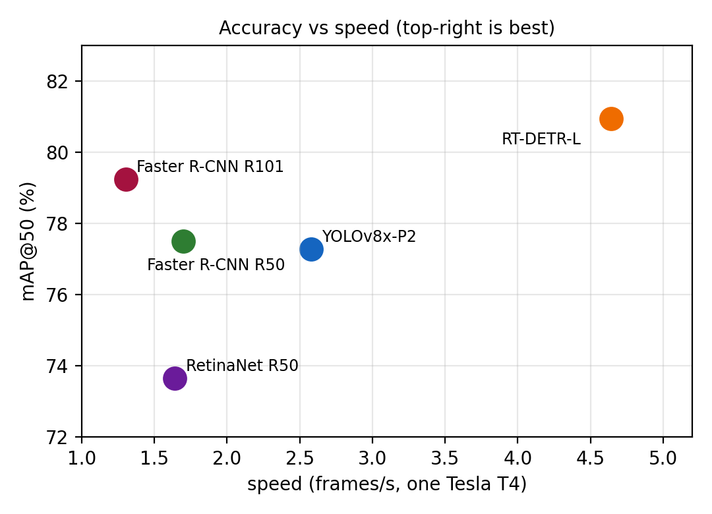

# Coastal Human Surveillance — Project Documentation

**Dual-Zone Pedestrian & Swimmer Risk Analytics via High-Resolution Vision Detectors**

| | |
|---|---|
| **Course** | 23CSE498 – Project Phase II |
| **Team** | G110 — Department of Computer Science and Engineering, Amrita School of Computing, Amrita Vishwa Vidyapeetham, Coimbatore |
| **Guide** | Ms. R. Sujee, Assistant Professor, Department of CSE |
| **Project report** | [`Phase2/Report/G110_Phase2_Report.pdf`](../Phase2/Report/G110_Phase2_Report.pdf) |
| **Website** | https://mbalajisakthivel007.github.io/G110_Website/ |

---

## Contents

1. [Abstract](#1-abstract)
2. [Problem statement and objectives](#2-problem-statement-and-objectives)
3. [System architecture](#3-system-architecture)
4. [Dataset](#4-dataset)
5. [Methodology — one protocol for all models](#5-methodology--one-protocol-for-all-models)
6. [The five detectors](#6-the-five-detectors)
7. [Results](#7-results)
8. [Key findings](#8-key-findings)
9. [Outputs and demonstration](#9-outputs-and-demonstration)
10. [How to reproduce](#10-how-to-reproduce)
11. [Repository structure](#11-repository-structure)
12. [Team](#12-team)
13. [Limitations and future scope](#13-limitations-and-future-scope)
14. [References](#14-references)

---

## 1. Abstract

Lifeguards watching crowded beaches must keep track of how many people are on the sand and how many are in the
water, often for hours and in bright glare. Automating this with ordinary CCTV is hard: swimmers far from the
camera are only 15–40 pixels tall, people overlap in crowds, and umbrellas, boats and waves cause false alarms.
Public person-detection datasets do not separate people *on land* from people *in the water*, so existing detectors
cannot provide this information directly.

We built our own two-class dataset (land / water), published on Roboflow as **G110-BEACH-PEOPLE-FINAL** (version 2),
from two public fixed beach webcams, and trained and evaluated **five deep detectors under one identical protocol**.
The transformer detector **RT-DETR-L** is the best model with **80.94 % mAP@50**, the best accuracy on swimmers and
the highest speed (4.64 frames/s on one Tesla T4). Faster R-CNN R101-FPN follows with 79.24 % and has the best F1 and
the best accuracy on people on land. Land / water confusions stay below 1 % for all five models, and the per-frame
land / water counts have a mean error of 1–3 people per frame.

---

## 2. Problem statement and objectives

**Problem statement.** Given a frame from a fixed beach camera, detect every visible person, classify each one as
**on land (class 0)** or **in the water (class 1)**, and report the land and water head-counts per frame. The scope is
daylight footage from fixed CCTV-style cameras; people on boats are out of scope. The per-frame counts are the input
for drowning-risk alerts and a lifeguard dashboard.

**Objectives**

1. Build a verified two-class beach CCTV dataset with a clip-wise split and a visually verified test set.
2. Train five detectors of different design families — two-stage, one-stage, anchor-free with a small-object head,
   and transformer — and compare them with one identical evaluation protocol.
3. Measure the effect of common techniques *with and without* them (denoising, CLAHE, NMS threshold, test-time
   augmentation, transfer learning) and the counting error per frame.

---

## 3. System architecture

**Initial design (Phase I)** — the complete coastal surveillance system:



**As built in Phase II** — from the beach webcams to the five detectors, the shared evaluation and the land / water
counts (dashed boxes are the next steps):



---

## 4. Dataset

The dataset was created by the team for this project.

| Step | What was done |
|---|---|
| 1. Capture | 48 clips of about 5 minutes from two public YouTube beach webcams: **White Bay, British Virgin Islands** (crowded) and **Sunny Isles, USA** (far, small people); 1920×1080 |
| 2. Frames | one frame every 3 s; stream overlays (QR code, banner) masked in black |
| 3. Labelling | draft boxes on the first recording day, checked by eye → a fine-tuned YOLOv8x *labeller* labels the second day → verified cleaning rules remove boats, horizon boxes and static umbrella tops |
| 4. Land / water | each box's foot point is compared with a per-camera waterline polygon |
| 5. Split | **by clip**, so frames of one clip never appear in two splits; the test clips come from a different day |
| 6. Test completion | the test frames were completed by eye (far swimmers, seated and partly hidden people added) |

| Split | Frames | Boxes | Land | Water |
|---|---|---|---|---|
| Train | 3,454 | 132,027 | 57,634 | 74,393 |
| Validation | 782 | 31,443 | 13,558 | 17,885 |
| Test (people ≥ 15 px) | 399 | 11,918 | 4,546 | 7,372 |

**Dataset link:** [G110-BEACH-PEOPLE-FINAL — Roboflow, version 2](https://app.roboflow.com/mbalajis-workspace-g2gae/g110-beach-people-final/2)

---

## 5. Methodology — one protocol for all models

Every model is trained and scored with exactly the same rules, so the results can be compared directly.

| Rule | Value |
|---|---|
| Pretrained weights | COCO, then fine-tuned on the training split |
| Input resolution | 1280–1320 px (small swimmers need resolution; 640 px loses them) |
| Model selection | best checkpoint on the validation split |
| Score threshold | chosen on validation: τ\* = argmax (F1<sub>land</sub> + F1<sub>water</sub>) — the test set is never used |
| Matching | IoU ≥ 0.5 |
| Small people | test people shorter than 15 px are an *ignore region* (neither rewarded nor punished) |
| Metrics | COCO mAP@50 and mAP@50:95, per-class precision / recall / F1, 3×3 confusion matrix (land / water / background), per-camera and per-crowd-level results, per-frame counting error (MAE), speed (frames/s) |
| Hardware | Kaggle, NVIDIA Tesla T4 (16 GB) |

**Class rule.** For a box (x₁, y₁, x₂, y₂) the foot point is f = ((x₁ + x₂) / 2, y₂); the person is *in the water*
(class 1) if f lies inside the camera's water polygon, otherwise *on land* (class 0).

**Counting error.** MAE = (1 / N) Σₖ | n<sub>pred,k</sub> − n<sub>GT,k</sub> | per class over the test frames.

---

## 6. The five detectors

| # | Detector | Family | Framework | Owner | Documentation |
|---|---|---|---|---|---|
| 1 | **Faster R-CNN R101-FPN** | two-stage | Detectron2 | M. Balaji Sakthivel (CB.SC.U4CSE23213) | [Detectron2_FasterRCNN_R101_Documentation.md](../Phase2/Detectron2/Detectron2_FasterRCNN_R101_Documentation.md) |
| 2 | **Faster R-CNN R50-FPN** | two-stage, lighter backbone | Detectron2 | Bhargava Ram Kaza (CB.SC.U4CSE23711) | [FasterRCNN_R50_Documentation.md](../Phase2/FasterRCNN/FasterRCNN_R50_Documentation.md) |
| 3 | **YOLOv8x-P2** | one-stage, anchor-free + small-object head | Ultralytics | R. Shanmugham (CB.SC.U4CSE23257) | [YOLOv8x_P2_Documentation.md](../Phase2/YOLO/YOLOv8x_P2_Documentation.md) |
| 4 | **RT-DETR-L** | detection transformer, no NMS | Ultralytics | Chitturi Venkata Chaitanya (CB.SC.U4CSE23214) | [RTDETR_L_Documentation.md](../Phase2/RT-DETR/RTDETR_L_Documentation.md) |
| 5 | **RetinaNet R50-FPN** | one-stage with Focal Loss | Detectron2 | Shaik Ibbraheem (CB.SC.U4CSE23742) | [RetinaNet_R50_Documentation.md](../Phase2/RetinaNet/RetinaNet_R50_Documentation.md) |

Each model document explains how the model works, its training configuration, the steps that were followed,
all results, figures, output videos and how to reproduce it.

---

## 7. Results

All numbers are on the same 399 test frames (4,546 land + 7,372 water people).

### 7.1 Main comparison

| Model | mAP@50 | mAP@50:95 | AP50 land | AP50 water | F1 (weighted) | FPS | Threshold |
|---|---|---|---|---|---|---|---|
| **RT-DETR-L** | **80.94** | **44.83** | 81.65 | **80.23** | 78.42 | **4.64** | 0.60 |
| Faster R-CNN R101-FPN | 79.24 | 41.87 | **83.89** | 74.59 | **79.83** | 1.30 | 0.60 |
| Faster R-CNN R50-FPN | 77.50 | 40.15 | 82.01 | 73.00 | 78.47 | 1.70 | 0.60 |
| YOLOv8x-P2 | 77.28 | 41.42 | 79.04 | 75.51 | 76.96 | 2.58 | 0.30 |
| RetinaNet R50-FPN | 73.66 | 33.57 | 75.84 | 71.47 | 72.94 | 1.64 | 0.30 |
| COCO model, no fine-tuning (R101) | 59.29 | – | – | – | 57.21 | – | – |

### 7.2 Per class, per camera and counting error

| Model | P / R land | P / R water | mAP@50 White Bay | mAP@50 Sunny Isles | MAE White Bay (land / water) | MAE Sunny Isles (land / water) |
|---|---|---|---|---|---|---|
| RT-DETR-L | 76.31 / 76.33 | **81.59** / **77.93** | **83.78** | 68.96 | 2.11 / **2.57** | 1.84 / 1.53 |
| Faster R-CNN R101-FPN | **81.48** / **79.85** | 81.53 / 77.22 | 81.78 | **69.16** | **1.44** / 2.64 | **1.02** / **1.44** |
| Faster R-CNN R50-FPN | 80.33 / 78.42 | 79.64 / 76.29 | 80.84 | 66.84 | 1.96 / 2.88 | 1.36 / 1.45 |
| YOLOv8x-P2 | 74.00 / 76.31 | 78.76 / 77.43 | 80.79 | 60.55 | 2.06 / 2.82 | 1.27 / 1.76 |
| RetinaNet R50-FPN | 68.58 / 72.42 | 77.51 / 71.68 | 76.67 | 62.51 | 2.44 / 3.43 | 1.28 / 1.84 |

Average people per frame (ground truth): White Bay 17.4 land / 32.6 water; Sunny Isles 5.4 land / 4.3 water.

### 7.3 With / without study (AP50, %)

| Variant | R101 | R50 | YOLOv8x-P2 | RT-DETR-L | RetinaNet |
|---|---|---|---|---|---|
| Baseline (raw frames) | 79.24 | 77.50 | 77.28 | **80.94** | 73.66 |
| Bilateral denoising | 75.96 | 74.70 | 75.50 | 79.02 | 71.06 |
| CLAHE | **80.13** | **79.47** | 77.29 | 79.80 | 73.80 |
| Denoising + CLAHE | 78.02 | 76.60 | 76.11 | 78.15 | 72.02 |
| NMS 0.3 / 0.7 | 77.91 / 79.37 | 75.94 / 77.89 | 75.56 / 77.53 | 80.94 / 80.94 \* | 71.90 / 72.56 |
| Test-time augmentation | 77.95 | 77.81 | **78.83** | 80.94 \* | **75.98** |
| COCO model, no fine-tuning | 59.29 | not run | 59.00 | 66.55 | 51.41 |

\* RT-DETR-L has no NMS and its Ultralytics version does not run test-time augmentation, so these variants equal the baseline.

### 7.4 Comparison charts

| All five models on the same test set | Accuracy vs speed (top-right is best) |
|---|---|
|  |  |

---

## 8. Key findings

- **RT-DETR-L is the recommended model for a live system:** highest mAP, best on swimmers and the fastest. Its
  attention sees the whole frame and its one-to-one set prediction needs no NMS, so neighbouring swimmers are not merged.
- **Faster R-CNN R101-FPN is the most balanced:** best F1, best on people on land and the lowest counting error,
  but the slowest.
- **Backbone depth:** R101 adds 1.74 mAP@50 over R50, while R50 is about 30 % faster.
- **Two-stage vs one-stage:** with the same backbone and schedule, Faster R-CNN R50 is 3.8 points better than RetinaNet —
  the proposal + RoI refinement stage matters for small, crowded people.
- **Fine-tuning is essential** (+14–22 points over a plain COCO model); **denoising hurts every model** (it blurs small
  people); **CLAHE helps the two-stage models** against glare; **TTA helps YOLOv8x-P2 and RetinaNet**.
- **Land and water are almost never confused** (below 1 % for all models). The remaining errors are mainly missed
  far swimmers and people hidden by umbrellas. All models are weaker on Sunny Isles (60–69 %) than on White Bay (77–84 %).
- **Counting:** a mean error of 1–3 people per frame on scenes with up to 50 people — usable as a live overview.

---

## 9. Outputs and demonstration

Every model produces the same outputs in its `Output/` folder:

| Output | Content |
|---|---|
| `Charts/` | training curves, confusion matrices, precision–recall curves, threshold sweep, per-class AP / AR, per-camera results, counts over time |
| `Sample_Frames/` | ground truth vs model frames, pre-processing comparisons |
| `Metrics/` | COCO metrics, confusion matrices, per-camera results, per-frame counts, threshold choice, configuration used |
| `Videos/` | ground truth vs model videos for every test clip, and real-speed videos with a live land / water count in the header |

---

## 10. How to reproduce

1. Open the model's notebook from `Phase2/<model>/Notebooks/` on Kaggle with **GPU T4** and **Internet** enabled.
2. Add your Roboflow API key as a Kaggle secret named `ROBOFLOW_API_KEY` (Add-ons → Secrets), or paste it where
   the notebook says `PASTE_YOUR_ROBOFLOW_KEY_HERE`. **Never commit a real key.**
3. Run all cells: the notebook downloads the dataset, trains, selects the best checkpoint and threshold on
   validation, evaluates once on the test split and writes all charts, metrics and videos.
4. To skip training, download the trained weights from the
   [repository releases](https://github.com/MBalajiSakthivel007/G110_Github/releases).

---

## 11. Repository structure

```
G110_Github/
├── README.md
├── docs/
│   ├── Phase2_Project_Documentation.md     (this document)
│   └── images/
└── Phase2/
    ├── Architecture/       system and model architecture diagrams
    ├── Report/             project report (PDF)
    ├── References/         literature survey papers with official links
    ├── Detectron2/         Faster R-CNN R101-FPN
    ├── FasterRCNN/         Faster R-CNN R50-FPN
    ├── YOLO/               YOLOv8x-P2
    ├── RT-DETR/            RT-DETR-L
    └── RetinaNet/          RetinaNet R50-FPN
        (each model: <Model>_Documentation.md, Notebooks/, Output/)
```

---

## 12. Team

| Register number | Name | Model |
|---|---|---|
| CB.SC.U4CSE23213 | M. Balaji Sakthivel | Faster R-CNN R101-FPN (Detectron2) |
| CB.SC.U4CSE23214 | Chitturi Venkata Chaitanya | RT-DETR-L |
| CB.SC.U4CSE23257 | R. Shanmugham | YOLOv8x-P2 |
| CB.SC.U4CSE23711 | Bhargava Ram Kaza | Faster R-CNN R50-FPN |
| CB.SC.U4CSE23742 | Shaik Ibbraheem | RetinaNet R50-FPN |

**Guide:** Ms. R. Sujee, Assistant Professor, Department of CSE, Amrita Vishwa Vidyapeetham, Coimbatore.

---

## 13. Limitations and future scope

**Limitations:** two cameras and two recording days; daylight only; very small or fully hidden people are still
missed; training length is limited by Kaggle's 12-hour session limit.

**Future scope:** tracking across frames for stable counts; a water-zone risk index with lifeguard alerts and a live
dashboard; longer training for YOLOv8x-P2; a lower threshold search for RetinaNet; tests on a new, unseen beach;
edge deployment of RT-DETR-L.

---

## 14. References

The literature survey (20 IEEE papers) is listed with official links in
[`Phase2/References/Literature_Survey_Papers.md`](../Phase2/References/Literature_Survey_Papers.md).
Key papers for the five detectors:

1. S. Ren, K. He, R. Girshick, and J. Sun, "Faster R-CNN: Towards real-time object detection with region proposal networks," *IEEE TPAMI*, vol. 39, no. 6, pp. 1137–1149, 2017.
2. T.-Y. Lin, P. Goyal, R. Girshick, K. He, and P. Dollár, "Focal loss for dense object detection," in *Proc. IEEE ICCV*, 2017, pp. 2980–2988.
3. M. Hussain, "YOLOv1 to v8: Unveiling Each Variant—A Comprehensive Review of YOLO," *IEEE Access*, vol. 12, pp. 42816–42833, 2024.
4. Y. Zhao *et al.*, "DETRs Beat YOLOs on Real-time Object Detection," in *Proc. IEEE/CVF CVPR*, 2024, pp. 16965–16974.
5. R. Da-Silva-Gomez *et al.*, "Real-Time Beach Monitoring: Addressing Beach Safety with UAVs and Computer Vision," in *Proc. IEEE ROBOT*, 2024.
